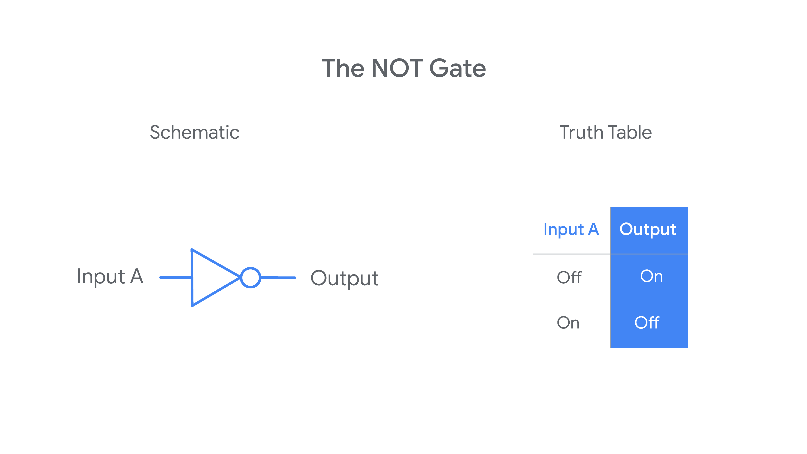
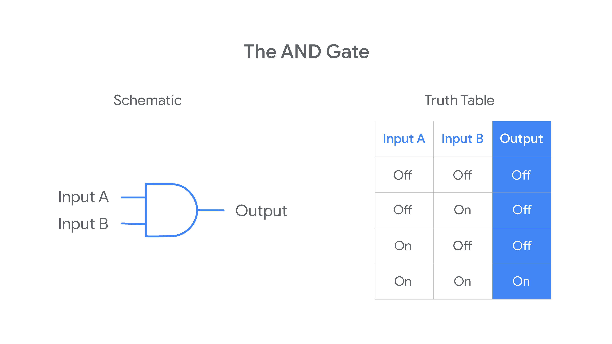
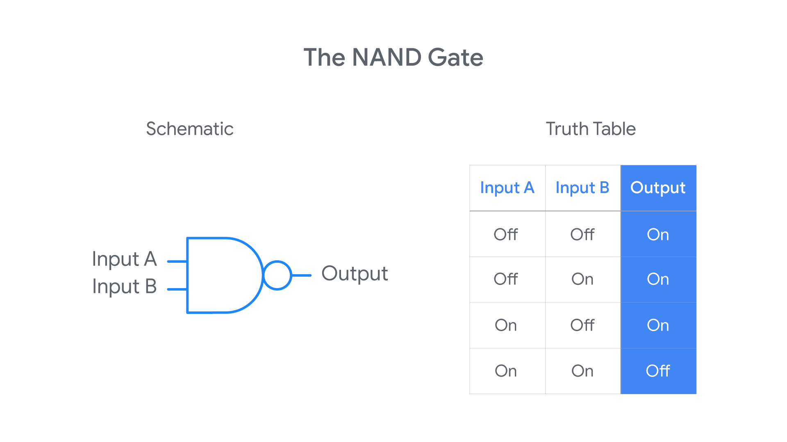
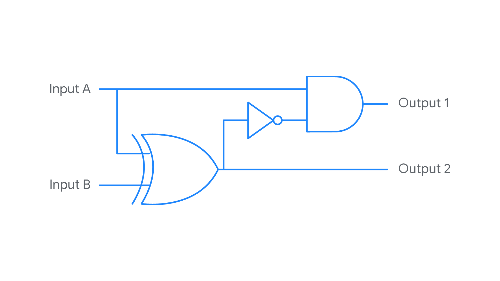
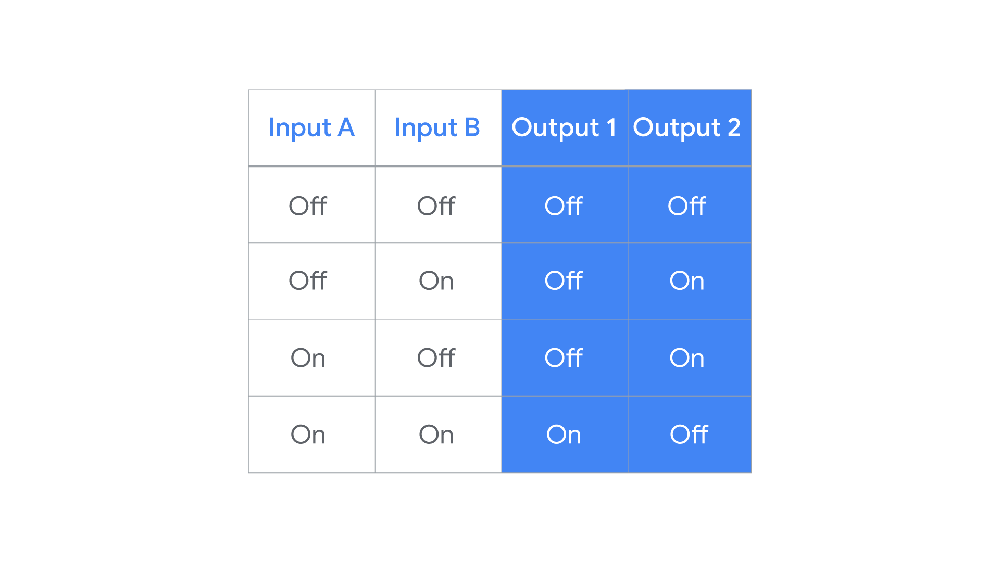

These notes cover everything in the Module 1 videos and readings, and expand on each idea so that someone with **no background in computers** can follow along. Every new term is explained the first time it appears, and there is a full glossary at the end.

**How to read these notes**

Throughout the notes you will see a few kinds of boxes:

> **Key idea:** The single most important thing to remember from a section.

> **Analogy:** A comparison to everyday life that makes an abstract idea easier to picture.

> **Clarification:** A spot where the video simplified something or misspoke, with the more precise version.

> **Going further:** Optional extra detail that goes beyond the course. Safe to skip on a first read.

> **Try it:** A small exercise. Answers are at the very end of the notes.

---

## Table of Contents

1. [Part 1: Welcome to IT](#part-1-welcome-to-it) — the program, what IT is, the digital divide, what IT support specialists do
2. [Part 2: The History of Computing](#part-2-the-history-of-computing) — from the abacus to the smartphone
3. [Part 3: Computer Language — Binary](#part-3-computer-language--binary) — bits, bytes, and why computers speak in 1s and 0s
4. [Part 4: Character Encoding and Color](#part-4-character-encoding-and-color) — ASCII, Unicode, UTF-8, and RGB
5. [Part 5: Where Do the 1s and 0s Come From?](#part-5-where-do-the-1s-and-0s-come-from) — light switches, punch cards, transistors
6. [Part 6: Logic Gates](#part-6-logic-gates) — NOT, AND, OR, XOR, NAND, XNOR, and building circuits
7. [Part 7: Counting in Binary](#part-7-counting-in-binary) — converting between binary and decimal by hand
8. [Part 8: Abstraction](#part-8-abstraction) — hiding complexity behind a simple interface
9. [Part 9: Computer Architecture Overview](#part-9-computer-architecture-overview) — the four layers of a computer
10. [Glossary](#glossary)
11. [Key Takeaways](#key-takeaways)
12. [Answers to the "Try it" Exercises](#answers-to-the-try-it-exercises)

---

## Part 1: Welcome to IT

### 1.1 The program at a glance

**The problem the program is trying to solve.** There are hundreds of thousands of open IT support jobs at companies of every size, and the number keeps growing because almost every business now depends on technology. At the same time, many people who would be good at these jobs face obstacles to getting trained: they may not have a university degree, they may not be able to attend in-person classes, or the training may simply cost too much.

**The goal of the program.** It teaches the foundational skills and confidence needed for an **entry-level IT support role**. "Entry-level" means a first job in the field that does not require previous professional experience. The role might be:

- **In-person support** — you physically walk to someone's desk, or they bring their laptop to you.
- **Remote support** — you help people over the phone, chat, email, or by remotely controlling their computer over the internet.
- Or a mix of both.

**How it teaches.** Instead of only lectures, the program uses hands-on **labs** (practice environments where you do real tasks on real or simulated computers) and interactive exercises, modeled on what you would actually do at a **help desk** — the team inside an organization that people contact when their technology isn't working.

**After you finish.** You get the chance to share your information with Google, Bank of America, and other large employers looking to hire entry-level IT support staff. All of the content was created by Google employees ("Googlers") who work in IT.

**The five courses in the certificate**

| # | Course | What it's about, in plain words |
|---|--------|----------------------------------|
| 1 | Technical Support Fundamentals | A tour of everything: how computers work, hardware, operating systems, the internet, software, troubleshooting, and customer service. *(These notes are part of this course.)* |
| 2 | The Bits and Bytes of Computer Networking | How computers connect to and talk with each other, from a home Wi-Fi network up to the whole internet. |
| 3 | Operating Systems and You: Becoming a Power User | A deep dive into operating systems such as Windows and Linux — the software that runs a computer. |
| 4 | System Administration and IT Infrastructure Services | How to manage the computers, user accounts, and services of an entire organization rather than one machine at a time. |
| 5 | IT Security: Defense against the Digital Dark Arts | How to protect systems and data from attackers and other risks. |

**Time commitment.** The video says that at around **8–10 hours per week**, most learners finish the whole certificate in about **eight months**. (Coursera updates the program from time to time, so the estimate on the course page may differ.)

**Learning at your own pace.** You can move as fast or slow as you like, skip material you already know, or go back and rewatch lessons. The course calls it a "choose your own adventure" experience. Finishing the program is also presented as a signal to employers that you have the persistence to keep learning in a field that changes constantly.

**The instructors**

All the instructors have worked in IT support at Google and later moved into other areas — which is itself a point the program makes: IT support is a *launchpad* into many careers.

| Instructor | Role at Google (at time of recording) | Teaches |
|------------|----------------------------------------|---------|
| Kevin Limehouse | Support Specialist for platforms in DoubleClick | History of computing (Course 1) |
| Victor Escobedo | Corporate Operations Engineer | The internet (Course 1); Computer Networking (Course 2) |
| Cindy Quach | Site Reliability Engineering | Operating systems (Course 1); Operating Systems (Course 3) |
| Devan Sridharan | Corporate Operations Engineering | Hardware and building a computer (Course 1); System Administration (Course 4) |
| Phelan Vendeville | Systems Engineer, Site Reliability team | Software (Course 1) |
| Gian Spicuzza | Program Manager, Android Security | History and impact of the internet (Course 1); IT Security (Course 5) |
| Marty Clark | Manager, internal IT support team | Troubleshooting, customer service, documentation (Course 1) |
| Rob Clifton | Program Manager | Interview tips (Course 1) and technical interview scenarios at the end of each course |

> **Going further:** A few job titles above may be unfamiliar. **Site Reliability Engineering (SRE)** is the practice of keeping large online services (like Gmail or YouTube) running reliably. **Operations engineering** focuses on running and maintaining the systems a company depends on. **Systems administration** means managing an organization's computers, servers, and accounts. You don't need to understand these yet — just know that IT support can lead to all of them.

---

### 1.2 What is information technology (IT)?

The first instructor, Kevin Limehouse, describes how he got hooked on IT at eight years old by taking apart his parents' old broken computer, and how by age 12 or 13 he had become the unofficial tech support for his large extended family. His story illustrates something common in IT: curiosity and a willingness to take things apart and figure them out matter a lot.

**Definition**

> **Key idea:** **Information technology (IT)** is the use of digital technology, like computers and the internet, to **store** and **process** data into **useful information**.

Let's unpack each part of that definition:

- **Digital technology** — devices and systems that work with information as numbers (ultimately as 1s and 0s, which you'll learn about in Part 3). Computers, smartphones, servers, and the internet are all digital technology.
- **Store** — keeping data somewhere so it can be used later: on a hard drive, a USB stick, or a server in a data center.
- **Process** — doing something with the data: sorting it, calculating with it, searching it, combining it, displaying it.
- **Data vs. information** — these are not the same thing:
  - **Data** is raw facts with no context. Example: `21, 23, 19, 22, 24`.
  - **Information** is data that has been processed so it means something to a person. Example: *"The average temperature in Berlin this week was 21.8 °C."*

> **Analogy:** A supermarket records every item scanned at every checkout — millions of rows of raw data. On its own, that data isn't useful to a manager. IT systems process it into information such as *"We sell the most bread on Saturday mornings, so we should bake more on Friday night."* That transformation — from raw data to something a human can act on — is the heart of IT.

**The IT industry**

The **IT industry** refers to the entire range of jobs and resources related to computing technology in society. Some examples of roles:

- **Network engineers** make sure computers can communicate with each other.
- **Hardware technicians** replace and repair physical components (screens, hard drives, keyboards).
- **Desktop support personnel** make sure **end users** (the everyday people who use the technology — accountants, teachers, salespeople) can use their software properly.

**IT is really about people**

IT is not just about building computers and using the internet. The course stresses that people are the "heart and soul" of IT support work: technology and information are useless if people can't use the technology or make sense of the information. That's why IT shows up in virtually every industry — education, medicine, journalism, construction, transportation, entertainment, and more. IT changes how we **collaborate, share, and create** together.

---

### 1.3 The digital divide

Because IT has become so central to modern life, people and organizations **without** access to it are at a real disadvantage. Everyday tasks increasingly require IT skills: finding and applying for a job, getting an education, managing a bank account, or looking up health information.

**Digital literacy** is the ability to use digital technology to find, understand, create, and communicate information — for example, knowing how to search the web effectively, send an email with an attachment, or recognize a suspicious link.

> **Key idea:** The **digital divide** is the growing skills gap between people who have digital literacy skills and people who do not.

**Why does the divide exist?** There are many social and economic reasons, for example:

- Growing up in a community with no internet connection, or very slow internet.
- Not being able to afford a computer, or only having access to one at school or a public library.
- Never having had anyone to teach you.

**Why it matters to you.** People without digital literacy skills are falling further behind as more of life moves online. The course argues that people entering IT are part of the solution: by helping users in your community and organization, and by understanding the social and economic factors behind the divide, you help close it. People from diverse backgrounds also bring new perspectives and ideas into the industry.

---

### 1.4 The work of an IT support specialist

There is no single "typical day" in IT support — it depends a lot on whether you work in person or remotely, and whether you're at a small business (where you might be the *only* IT person and do everything) or a large enterprise (where you might be part of a big team with specialized roles). The problems are always new, which is part of the appeal.

**In general, an IT support specialist makes sure an organization's technology is running smoothly.** That includes five kinds of work:

| Task | What it means | Example |
|------|---------------|---------|
| **Managing** | Keeping track of equipment and accounts | Knowing which employee has which laptop; creating an account for a new hire |
| **Installing** | Setting up new hardware or software | Installing an office suite or a printer driver on a new computer |
| **Maintaining** | Keeping things in good condition over time | Applying software updates; replacing a failing battery |
| **Troubleshooting** | Finding the cause of a problem and fixing it | Figuring out why a user can't connect to Wi-Fi |
| **Configuring** | Adjusting settings so things work the way the organization needs | Setting up email on a phone; setting which printer is the default |

**What this program will teach you to do**

- Set up a user's **desktop** or **workstation** (the computer and accessories a person works at).
- Install the applications people use most.
- **Troubleshoot** problems when something goes wrong — and put practices in place to **prevent** the same problem from happening again.
- **Communicate** with users so you can understand their problem and help them effectively. (Technical skill alone isn't enough.)
- Set up a **network** from scratch and connect it to the internet.
- Use **automation and scripting** — writing small programs so the computer does repetitive tasks for you.
- Implement **security** so systems are safe from hackers and other risks.

**The mindset of IT support**

- **Problem solving and creativity.** The instructor's favorite part is coming up with a creative solution to a user's issue.
- **Being a generalist.** Entry-level IT support exposes you to many different skills, which helps you discover what you want to specialize in later.
- **Using failure as feedback.** When something goes wrong, the mistake teaches you how to handle it better next time. This is presented as an important skill both in IT and in life.

**Job outlook.** At the time of recording, the course cited a projection that IT jobs in the US would grow by about **12% over the following decade** — faster than the average for all occupations — with thousands of companies worldwide looking for IT professionals.

---

## Part 2: The History of Computing

### 2.1 Why study history?

**The Apollo 11 story.** On **July 20, 1969**, Apollo 11 landed on the Moon. Alongside the brilliant people involved, computers played a major role: the guidance computer that helped navigate the spacecraft was one of the earliest forms of modern computing. The course's point is how dramatically things have changed since then — the computing technology of that era was a tiny fraction (the video says around 1/10,000) of the power of the smartphone in your pocket.

> **Clarification:** The video says the Apollo computer "took up the space of an entire room." The computers in NASA's Mission Control on the ground did fill rooms, but the **Apollo Guidance Computer** on board the spacecraft was about the size of a large briefcase, weighed roughly 32 kg, and had only a few kilobytes of working memory. The main point stands either way: a modern phone is enormously more powerful.

**Computers are everywhere.** Think about your day: the fridge that keeps your snack cold, your TV, your car — many of them contain computers. What used to power rockets now shapes how the whole world works.

**What Course 1 covers.** By the end of the course you'll understand:

- How computer **hardware** performs calculations — and you'll build a computer from its parts.
- How **operating systems** control and interact with hardware.
- How the **internet** works and how computers talk to each other.
- How **applications and programs** tie everything together and let humans interact with computers.
- **Problem solving** with computers, and the **communication skills** needed when working with people in IT.

**Why history helps.** Knowing where technology came from explains why things work the way they do today. The course's example:

> **Analogy — the QWERTY keyboard:** Most keyboards in the world use the **QWERTY** layout, named after the first six letters on the top row. Strangely, the letters you type most often aren't on the "home row" where your fingers rest. Why? Nobody is completely sure. One popular story says the layout was designed to slow typists down so the metal arms of mechanical typewriters wouldn't jam; another says it solved a problem for telegraph operators. What *is* certain is that it isn't the most efficient layout — alternatives (like Dvorak) have been designed — yet we still use it because of history. Many things in computing are like this: they make sense only once you know their backstory.

> **Going further:** In Germany you'll mostly see the **QWERTZ** layout, where Y and Z are swapped and keys are added for ä, ö, ü, and ß. It's a variation on the same historical design.

---

### 2.2 What is a computer, really?

When you hear "computer," you might picture a gaming desktop with flashing lights or a slim laptop. But the original idea was much simpler.

> **Key idea:** A **computer** is a device that **stores and processes data by performing calculations**.

Before computing machines existed, the word *computer* was a **job title**: a person whose job was to do calculations by hand. Teams of human computers worked out things like navigation tables and engineering calculations. (A famous later example: Katherine Johnson and her colleagues at NASA, whose hand calculations helped send astronauts into orbit and to the Moon.)

**"But my computer does so much more than calculate!"** You might think: *my computer lets me browse social media, play games, design graphics — that's not just calculation.* But underneath, every one of those activities **is** calculation:

- Applying a filter to a photo = doing arithmetic on the numbers that represent each pixel's color.
- A video game = constantly calculating where every character and object should be, many times per second.
- Scrolling social media = calculating which posts to fetch, how to lay them out, and what color each dot on your screen should be.

The rest of this module shows how those calculations happen.

---

### 2.3 The abacus — one of the earliest computers

An **abacus** looks like a wooden children's toy: a frame with rods, and beads that slide along the rods. But it's one of the earliest known computing tools. The course dates it to around **500 BC**, invented to count large numbers. (Counting boards and abacus-like tools go back even further, to ancient Mesopotamia.)

**How it works.** Each rod stands for a **place value** — for example, one rod for ones, the next for tens, the next for hundreds. You represent a number by sliding beads, and you add or subtract by moving beads according to simple rules.

The abacus is still used today, especially for teaching arithmetic. But note its big limitation: **a human still does all the work**. The abacus only helps you keep track of numbers; it doesn't calculate on its own. The same was true of the more advanced counting tools that followed over the centuries.

---

### 2.4 The mechanical calculator — Blaise Pascal (17th century)

The first major step forward was the **mechanical calculator**, invented by the French mathematician **Blaise Pascal** in the 1600s (his machine, the *Pascaline*, dates from 1642).

**How it works.** It used a series of **gears and levers**. When you turned a dial to enter a number, the gears moved, and when one wheel went past 9 it automatically nudged the next wheel forward by one — the same way a car's odometer rolls from 0009 to 0010. This automatic "carrying" meant the machine did part of the calculation **for** the user.

**Limitations.** It was limited to the four basic operations — addition, subtraction, multiplication, and division (the last two done through repeated addition and subtraction) — and only for fairly small numbers.

**Why it mattered.** It proved that a machine could perform calculations automatically, which paved the way for more complex machines. Its basic ideas would soon be applied somewhere unexpected: the textile industry.

---

### 2.5 Jacquard's loom and the punch card (1800s)

**The problem.** A **loom** is a machine that weaves yarn or thread into fabric. Before modern factories, weaving a *pattern* into fabric took an enormous amount of manual work: for every single row, someone had to decide which threads to lift and which to leave down.

**The invention.** In the early 1800s (1804), **Joseph Marie Jacquard** invented a **programmable loom**. It read a sequence of stiff cards with holes punched in them — **punch cards**:

- Where the loom found a **hole**, a hook passed through and lifted the thread underneath.
- Where there was **no hole**, the hook was blocked and that thread was not lifted.

Each card controlled one row of the weave. Chain hundreds of cards together and the loom wove an intricate pattern automatically.

> **Key idea:** Jacquard's loom contains two ideas that are at the heart of every computer today:
> 1. **Programmability** — to weave a different pattern, you didn't rebuild the machine; you just fed it a different set of cards. The *instructions* were separate from the *machine*.
> 2. **Two states** — every position on a card was either a hole or not a hole: **on or off**. This is exactly the idea behind **binary** (Part 3).

Jacquard transformed the textile industry, and almost certainly had no idea he was also shaping the future of computing.

---

### 2.6 Charles Babbage — the Difference Engine and the Analytical Engine

A few decades later, the English engineer and mathematician **Charles Babbage** designed a series of machines now regarded as the greatest breakthrough on the road to the modern computer.

**The Difference Engine.** This was a very sophisticated version of the mechanical calculator. Back then, scientists, engineers, and sailors relied on printed books of mathematical tables (for things like navigation), computed by hand by human computers — and they were full of errors. The Difference Engine was designed to calculate such tables automatically and accurately. It could perform fairly complicated mathematical operations, but nothing else: it was built for one job.

**The Analytical Engine.** Babbage's follow-up was far more ambitious. Inspired by **Jacquard's punch cards**, he designed the Analytical Engine to read its instructions from punch cards, so people could **pre-define a whole series of calculations** for it to perform automatically instead of entering each one by hand.

> **Going further:** The Analytical Engine's design looks surprisingly like a modern computer. It had a **"mill"** that performed the calculations (similar to today's processor, or CPU) and a **"store"** that held numbers waiting to be used (similar to today's memory). It could even make decisions — doing different things depending on a result.

> **Clarification:** Neither machine was fully built in Babbage's lifetime — the engineering of the era, and the funding, weren't up to it. In 1991, London's Science Museum built his Difference Engine No. 2 from his original plans, and it worked exactly as designed.

As impressive as it was, the Analytical Engine was, in Babbage's view, still just a very advanced mechanical calculator. Someone else saw its real potential.

---

### 2.7 Ada Lovelace — the first computer programmer

**Ada Lovelace**, a mathematician, studied the Analytical Engine and realized something Babbage hadn't fully appreciated: the machine could be used for **more than pure calculation**. If numbers could stand for other things — letters, musical notes, symbols — then a machine that manipulated numbers could manipulate *anything* that could be represented as numbers. That is exactly what computers do today.

She also wrote the **first algorithm** intended for the machine (published in 1843, for calculating a sequence of numbers called the Bernoulli numbers). This is considered the very first example of **computer programming**.

> **Key idea:** An **algorithm** is a series of steps that solves a specific problem.

> **Analogy:** A recipe is an algorithm. "Boil water. Add pasta. Wait 10 minutes. Drain." Each step is clear, they happen in order, and following them solves a problem (making dinner). Directions to a friend's house, the steps to reset a password, and the method you learned in school for long division are all algorithms too.

**Why this was a turning point.** Because of Lovelace's work, algorithms could be programmed into the Analytical Engine, making it — on paper — the first **general-purpose computing machine** in history.

- A **special-purpose** machine does one job (a pocket calculator only calculates; the Difference Engine only made tables).
- A **general-purpose** machine can do *many different* jobs depending on the instructions (the program) you give it. Your laptop is general-purpose: the same hardware can be a word processor, a game console, or a video player depending on which program runs.

The course also notes this as a great example that women have been among the most important minds in technology since the 1800s.

---

### 2.8 World War II and cryptography

Computing developed steadily after the Analytical Engine but didn't make a huge leap until **World War II** (1939–1945). Before the war, computing research was very expensive: electronic components were large, you needed a lot of them to compute anything useful, the machines took up a huge amount of space, and many projects were underfunded.

When war broke out, governments poured money and resources into computing research, hoping for technologies that would give them an advantage. One of the biggest areas was **cryptography**.

> **Key idea:** **Cryptography** is the art of writing and solving codes — more broadly, the discipline of encoding and hiding messages so that third parties can't read them.

> **Analogy:** The simplest code is a **shift cipher**: replace every letter with the letter three places later in the alphabet, so `HELLO` becomes `KHOOR`. Anyone who knows the rule ("shift back by 3") can read it; anyone who doesn't sees nonsense. Wartime codes were vastly more complex, and breaking them by hand could take far too long to be useful.

During the war, computing machines processed intercepted enemy messages far faster than any human could. (Well-known examples: at Britain's Bletchley Park, Alan Turing's team built electromechanical "Bombe" machines to help break the German Enigma code, and engineers built **Colossus**, one of the first electronic computers, to break another German cipher.)

Today, cryptography is a critical part of **computer security** — it protects your passwords, online banking, and messages. You'll learn more about it in Course 5.

---

### 2.9 After the war: new ways to store data

After the war, companies such as **IBM** and **Hewlett-Packard** pushed computing technology into universities, businesses, and government. The 20th century saw huge advances, driven by the interest of governments, scientists, and companies left over from the war effort. A big part of this was **new ways to store data**, which fueled the growth of computing power.

**Punch cards (until the 1950s).** Punch cards were a popular way to store data. Operators kept **decks** of cards in a precise order for processing. The obvious problem: if someone dropped a deck and the cards got shuffled, it was almost impossible to put them back in the right order.

**Magnetic tape.** New technology like **magnetic tape** let people store more data on more reliable media. Magnetic tape works by **magnetizing data onto a tape**: tiny regions of a long plastic strip coated with magnetic material are magnetized in one direction or the other, and those two directions can represent two states — again, on/off, 1/0. Stacks of punch cards were left to collect dust as tape revolutionized the industry.

> **Going further:** Magnetic tape is not dead. Large organizations still use tape cartridges today for long-term backups and archives because it's cheap and durable for storing huge amounts of data.

---

### 2.10 Vacuum tubes, ENIAC, and the first "bug"

Early computers were enormous. They needed huge machines to read data and **racks of vacuum tubes** to move that data around.

**Vacuum tubes** are glass tubes (looking a bit like light bulbs) that **control electrical voltages**. They were used in all kinds of electronic equipment — televisions, radios — not just computers. But they were bulky, got hot, and **broke all the time**.

**IT support in the early days.** Imagine the job: crawling around inside giant machines full of dust and insects, replacing burnt-out vacuum tubes, and swapping punch cards.

**The first "bug."** Computer scientist **Admiral Grace Hopper** loved to tell a story about engineers working on the **Harvard Mark II** computer (in 1947). They were trying to find the source of a problem in a **relay** (an electrically operated switch). The culprit turned out to be a **moth** stuck inside — a literal bug in the computer. The engineers taped the moth into their logbook with the note "First actual case of bug being found."

> **Clarification:** Engineers had already used the word "bug" for technical faults before this (Thomas Edison used it in the 1870s), which is why the logbook joke works. But the moth story made the term famous. Today a **bug** is any error in a program or system, and **debugging** is the process of finding and fixing it.

**ENIAC** was one of the earliest **general-purpose** electronic computers (completed in 1945). It was a wall-to-wall mass of electronics and wires: about **17,000 vacuum tubes**, taking up about **1,800 square feet** of floor space (roughly 167 m² — bigger than many houses) and weighing around 27 tonnes. You would not want to share an office with it.

---

### 2.11 Transistors

Eventually the industry replaced vacuum tubes with **transistors** (invented in 1947 at Bell Labs) to control electricity voltages.

> **Key idea:** A **transistor** is a tiny electronic component that can switch an electrical signal on or off, or control how much of it flows. Transistors do almost the same job as vacuum tubes, but they are **much smaller, more efficient, cheaper, and far more reliable**. They are now a fundamental component of all electronic devices.

> **Analogy:** Think of a transistor as a water tap where a small turn of the handle controls a large flow of water. In a transistor, a small electrical signal controls whether a larger current flows through. For computers, the important use is simply **open (on) or closed (off)**.

The scale today is hard to imagine: you can easily have **billions** of transistors on a single small computer chip. Part 5 explains how these on/off switches become the 1s and 0s computers work with.

---

### 2.12 The first compiler — Grace Hopper

Throughout the following decades, more and more advances were made. One of the most important: Admiral Grace Hopper invented the **first compiler** (in the early 1950s).

To understand why this matters, you need two terms:

- **Machine code** — the instructions a computer's processor actually understands, written entirely in 1s and 0s. Writing programs this way is slow, painful, and error-prone.
- **Programming language** — a way of writing instructions using words and symbols that humans can read, such as `print("Hello")`.

> **Key idea:** A **compiler** translates human-readable instructions written in a programming language into machine code (1s and 0s) that the computer can run.

> **Analogy:** A compiler is like a translator who takes a book written in English and produces a version in a language the reader understands. You write in the language you're comfortable with; the translator handles the conversion.

**The big takeaway:** this was a huge milestone. Because of compilers, nobody has to write machine code by hand anymore, and learning to program became accessible to almost anyone, anywhere. Programming languages became the main way engineers develop software.

---

### 2.13 Smaller and smaller: hard drives and microprocessors

The industry went on to produce the first **hard disk drives** and **microprocessors**:

- A **hard disk drive (HDD)** stores data magnetically on spinning metal disks (platters). IBM's first one (1956) stored about 5 million characters and was roughly the size of two large refrigerators. Today a hard drive that fits in your palm holds millions of times more.
- A **microprocessor** is an entire **processor** — the part of the computer that carries out instructions and calculations — built onto a single small chip. The first commercial one, the Intel 4004, appeared in 1971.

Thanks to advances like these, computers kept shrinking. Instead of filling entire rooms like ENIAC, they became small enough to fit on a **tabletop**.

---

### 2.14 The Xerox Alto and the graphical user interface (GUI)

The **Xerox Alto** (1973) was the first computer that resembled the computers we're familiar with today. It was also the first to use a **graphical user interface (GUI)** with **icons, a mouse, and windows**.

**What is a GUI?** Before GUIs, you controlled a computer by typing text commands, such as `copy report.txt backup`. This is called a **command-line interface (CLI)**. A **GUI** instead lets you interact by pointing and clicking on pictures: you drag a file's icon into a folder's icon to move it.

> **Analogy:** A CLI is like ordering at a restaurant by telling the waiter the exact name of the dish — you need to know what to say. A GUI is like a menu with pictures you can point at — much easier for a newcomer.

> **Clarification:** The Alto was mostly used for research inside Xerox and at universities rather than sold to the public. Its ideas, however, directly inspired the Apple Macintosh and Microsoft Windows.

**The start of the consumer age.** Historic computers were so big and expensive that an average family could never own one; they were found mainly in military and university research facilities. When companies started building machines that were smaller and relatively affordable, the **consumer age** of computing began.

---

### 2.15 The personal computer: Apple, IBM, and Microsoft

**Apple.** In the 1970s, a young engineer named **Steve Wozniak** invented the **Apple I** (1976), a **single-board computer** — all its main electronics on one circuit board — meant for **hobbyists** (enthusiasts who often supplied their own case, keyboard, and screen). With his friend **Steve Jobs**, he founded **Apple Computer**. Their follow-up, the **Apple II** (1977), was ready for the average consumer to use out of the box. It was a phenomenal success, on sale for nearly two decades, and gave a new generation access to **personal computers**. For the first time, computers were affordable for the middle class, bringing computing into both homes and offices.

**IBM and MS-DOS.** In 1981, IBM introduced its **Personal Computer (IBM PC)**. It shipped with a simple **operating system** called **MS-DOS** (Microsoft Disk Operating System).

- An **operating system (OS)** is the core software that manages the computer's hardware and lets you run other programs. (Much more on this in later lessons.)
- MS-DOS was **text-only**: you typed commands at a prompt like `C:\>` — no icons, no mouse. Compare that to the colorful icons and images of today's operating systems, like those on your smartphone.

**Microsoft Windows.** The IBM PC was widely adopted, thanks partly to its partnership with **Microsoft**, the company founded by **Bill Gates** (with Paul Allen). Microsoft eventually created **Windows**, which for decades was the preferred operating system in the workplace and dominated the industry.

> **Key idea:** Windows dominated largely because it could run on **any compatible hardware**, made by many different manufacturers. Apple's operating systems, by contrast, ran only on Apple's own machines.

**Why this matters for IT.** With more computers in the workplace, organizations depended more on IT — and demand rose for skilled workers who could support that technology. That's the origin of the job you're training for.

---

### 2.16 Video games

At the same time, a new kind of computing emerged: **video games**.

- In the 1970s and 80s, coin-operated entertainment machines called **arcades** became very popular.
- In **1972**, a company called **Atari** released **Pong**, one of the first coin-operated arcade games — a simple tennis-like game. It was such a sensation that people waited in line for hours at bars and recreation centers to play.
- Atari later launched the **Atari Video Computer System** (1977, later known as the Atari 2600), which helped bring video game **consoles** into homes.

**Why games matter in computing history.** Until then, computers were mainly used at work or in research institutions. Video games showed people that computers didn't have to be all work and no play — they could be a great source of entertainment. That broadened who wanted a computer, and the demand for better graphics and speed has pushed computer hardware forward ever since.

---

### 2.17 Unix, GNU, Linux, and open source

With Apple's Macintosh and Microsoft Windows taking over the operating system market, another story was unfolding.

**Unix.** **Unix** was an operating system developed by **Ken Thompson** and **Dennis Ritchie** (at Bell Labs, starting in 1969). It was powerful and influential, but it wasn't cheap and wasn't available to everyone.

**GNU.** A programmer named **Richard Stallman** started developing a free operating system with similar functionality to Unix, called **GNU** (a playful recursive name: "GNU's Not Unix"). Unlike Windows or Macintosh, GNU wasn't owned by a single company. Its code was **open source**.

> **Key idea:** **Open source** means the developers let anyone see, use, modify, and share the software's source code (the human-readable instructions it's built from), usually for free. The opposite is **proprietary** (or closed source) software, where the code is secret and owned by one company.

> **Analogy:** Proprietary software is like a dish at a restaurant: you can eat it, but the recipe is secret. Open-source software is like a recipe published openly — you can cook it, change it, and share your improved version with others.

**Linux.** GNU never became a complete operating system on its own, but it laid the foundation for one of the largest open-source operating systems: **Linux**, created by **Linus Torvalds** (in 1991).

> **Going further:** The missing piece of GNU was a finished **kernel** — the core part of an operating system that talks directly to the hardware. Torvalds wrote the Linux kernel, and combining it with GNU's tools produced a complete, free operating system (which is why some people call it "GNU/Linux"). Today Linux runs most of the world's web servers and supercomputers, and Android phones are built on the Linux kernel.

You'll get into the technical details of Linux later in this course and in Course 3. As an IT support specialist, you're very likely to work with open-source software — you may already use some, such as the **Mozilla Firefox** web browser.

---

### 2.18 Going mobile: PDAs and smartphones

By the early 1990s, computers were getting even smaller. Then a real game-changer arrived: **PDAs (personal digital assistants)**, which let computing go **mobile**. These handheld devices combined portable media players, word processors, email clients, internet browsers, and more in one device. (Well-known examples include the Apple Newton and the Palm Pilot.)

In the late 1990s, **Nokia** introduced a PDA with **mobile phone** functionality. This sparked the industry of pocket-sized computers we now call **smartphones**.

> **Key idea:** In just a few decades, we went from computers that weighed tons and filled entire rooms to powerful computers that fit in our pockets — and it's only the beginning.

---

### 2.19 How IT support has changed — and will keep changing

Computer support 50 years ago meant changing vacuum tubes and stacking punch cards — tasks that no longer exist. As computers grew in complexity and spread everywhere, the knowledge needed to support them changed too. In ten years, IT support might involve working through virtual reality headsets — nobody knows. The lesson: **technology changes constantly, so an IT professional must keep learning.** Now that you know where computers came from, the next parts explain how they actually work.

---

### 2.20 Timeline at a glance

| When | Milestone | Why it matters |
|------|-----------|----------------|
| ~500 BC | Abacus (per the course) | Early counting tool; humans do the work |
| 1642 | Pascal's mechanical calculator | First machine to calculate automatically with gears |
| 1804 | Jacquard's programmable loom | Punch cards; instructions separate from the machine; on/off states |
| 1820s–1830s | Babbage's Difference Engine and Analytical Engine | Designs for automatic, programmable computing machines |
| 1843 | Ada Lovelace's algorithm | First computer program; machines can do more than math |
| 1939–1945 | World War II | Huge investment in computing; cryptography and codebreaking |
| 1945 | ENIAC | Early general-purpose electronic computer; ~17,000 vacuum tubes |
| 1947 | Transistor invented; Harvard Mark II moth | Smaller, reliable switches; "bug" becomes famous |
| 1950s | Magnetic tape replaces punch cards; Grace Hopper's compiler | More reliable storage; programming in human-readable languages |
| 1956 | First hard disk drive (IBM) | Fast, rewritable storage |
| 1969 | Apollo 11 Moon landing; Unix begins | Computing in spaceflight; influential operating system |
| 1971 | First microprocessor (Intel 4004) | A whole processor on one chip |
| 1972 | Atari's Pong | Video game era begins |
| 1973 | Xerox Alto | First GUI with icons, windows, mouse |
| 1976–1977 | Apple I and Apple II | Personal computers for hobbyists, then the middle class |
| 1977 | Atari Video Computer System | Video game consoles enter the home |
| 1981 | IBM PC with MS-DOS | PCs spread through businesses |
| 1983 | Stallman starts GNU | Free, open-source software movement |
| 1985 | Microsoft Windows | Dominant workplace OS for decades |
| 1991 | Linux | Major open-source operating system |
| Early 1990s | PDAs | Computing goes mobile |
| Late 1990s | Nokia's PDA-phone | The path to today's smartphones |

---

## Part 3: Computer Language — Binary

### 3.1 What does a computer actually calculate?

Recall the definition: a computer stores and processes data by performing calculations. Whether it's an artificial intelligence that beats humans at chess or something simple like a video game, **the more computing power you have, the more you can accomplish.**

Consider a very simple problem: **0 + 1 = ?** It takes you a moment to answer 1. Now imagine doing 100 calculations that simple. You could manage it, and if you were careful you might not make a mistake. What about 1,000? A million? A billion?

> **Key idea:** At its core, a computer simply **compares and combines 1s and 0s — but millions or billions of times per second.** Its power doesn't come from doing anything clever in a single step; it comes from doing extremely simple steps unbelievably fast, without getting tired or making careless mistakes.

> **Going further:** You may have seen a processor advertised as "3 GHz." **GHz (gigahertz)** means billions of cycles per second, so a 3 GHz processor ticks through about 3 billion steps every second.

---

### 3.2 The binary system (base-2)

> **Key idea:** The way a computer communicates is called the **binary system**, also known as the **base-2 numeral system**. It uses only **two digits: 0 and 1**.

**What does "base" mean?** A number system's *base* is how many different digits it uses.

- The system humans normally use is **decimal**, or **base-10**: ten digits, 0 through 9. (Probably because we have ten fingers.)
- **Binary** is **base-2**: only two digits, 0 and 1.

You can write any number in either system — they're just two different ways of writing the same quantities. Part 7 shows exactly how.

**Why do computers use binary instead of decimal?** Because it's easy and reliable to build electronics with **two states**: a switch is on or off; there's electricity flowing or there isn't; a spot on a disk is magnetized one way or the other. Trying to reliably tell apart *ten* different levels of electricity would be much harder and more error-prone — a small fluctuation could turn a 6 into a 7. With only two states, a signal is either clearly "on" or clearly "off."

**"If my computer only talks in 1s and 0s, how do I communicate with it?"**

> **Analogy:** We use the 26 letters of the alphabet to build words, and we give those words meaning. From words we build sentences, paragraphs, and whole stories. Binary works the same way, except instead of A, B, C... we only have **0 and 1**. By grouping them into "words" and agreeing on what each one means, we can express anything.

---

### 3.3 Bits

> **Key idea:** A **bit** (short for **b**inary dig**it**) is a single 0 or 1. It is the smallest unit of data a computer can work with.

Think of a bit as one light switch: it can only be off (0) or on (1). One bit on its own can't say much — just "yes or no," "true or false." Things get interesting when you group bits together.

---

### 3.4 Bytes — and why eight bits?

> **Key idea:** A **byte** is a group of **8 bits**. For example: `10011011`.

**Why eight?** In the early days of computing, hardware used various numbers of bits. Eight bits gave a large enough range of values to do the computing that was needed at the time, and eventually grouping 8 bits together became the **industry standard** we still use today. (IBM's very influential System/360 computers in the 1960s helped cement the 8-bit byte.)

**How many values can a byte hold?** Each bit has 2 possible states. Every bit you add **doubles** the number of possible combinations:

- 1 bit: `0`, `1` → **2** combinations
- 2 bits: `00`, `01`, `10`, `11` → **4** combinations
- 3 bits: `000`, `001`, `010`, `011`, `100`, `101`, `110`, `111` → **8** combinations

| Number of bits | Combinations | Written as a power of 2 |
|---------------:|-------------:|:-----------------------:|
| 1 | 2 | 2¹ |
| 2 | 4 | 2² |
| 3 | 8 | 2³ |
| 4 | 16 | 2⁴ |
| 8 (one byte) | **256** | **2⁸** |
| 16 | 65,536 | 2¹⁶ |
| 32 | about 4.3 billion | 2³² |

So a byte has **2⁸ = 256 possible values** (2 × 2 × 2 × 2 × 2 × 2 × 2 × 2). In the oldest text encoding (Part 4), one byte stores **one character**, such as the letter `c`.

> **Going further — bigger units:** A **kilobyte (KB)** is about a thousand bytes, a **megabyte (MB)** about a million, a **gigabyte (GB)** about a billion, and a **terabyte (TB)** about a trillion. Strictly, the "metric" kilobyte is 1,000 bytes, while computers often count in powers of 2, where 1,024 bytes = 1 **kibibyte (KiB)**. This difference is why a "1 TB" drive shows up as about 931 GB in Windows — a common question from users. Also, a half-byte (4 bits) is jokingly called a **nibble**.

---

### 3.5 From 1s and 0s to meaning

A byte by itself is just a pattern of eight switches. What it *means* depends on how it's interpreted — the same byte could be a number, a letter, or part of a color. To turn bytes into something meaningful, everyone needs to agree on what each pattern stands for. That agreement is how a computer "language" is born.

Here's a small translation table, using the standard that maps bytes to letters (Part 4 explains it):

| Binary (what the computer sees) | Character (what we see) |
|:-------------------------------:|:-----------------------:|
| `01101000` | h |
| `01100101` | e |
| `01101100` | l |
| `01101100` | l |
| `01101111` | o |

Read top to bottom, the computer's five bytes spell **hello**.

> **Key idea:** **Everything** you see on your computer — videos, images, text, music, games — is ultimately nothing more than 1s and 0s. Binary is the basis for everything else in this course, so make sure this idea is clear before moving on.

---

## Part 4: Character Encoding and Color

### 4.1 What is character encoding?

You've seen that a byte has only 256 possible values. So how do we get all the words, numbers, punctuation, and emojis on our screens? The answer is **character encoding**.

> **Key idea:** **Character encoding** assigns binary values to characters so that humans can read them.

We definitely wouldn't want to read emails and web pages as endless strings of 0s and 1s. Character encoding sits in between.

> **Analogy:** Think of character encoding as a **dictionary** that the computer uses to look up which human character a given binary value stands for — and the other way around. When you type `a`, the computer looks it up and stores `01100001`. When it needs to show `01100001` on screen, it looks it up again and draws an `a`.

For this to work, the computer that **writes** text and the computer that **reads** it must use the **same dictionary**. If they use different ones, you get garbled text (see 4.3).

---

### 4.2 ASCII — the original standard

The oldest character encoding standard is **ASCII** (pronounced "ASK-ee"), short for the **American Standard Code for Information Interchange** (first published in 1963). It represents:

- The English alphabet — **uppercase and lowercase letters are separate characters** (`A` and `a` have different codes)
- The digits `0`–`9`
- Punctuation marks and common symbols (`!`, `?`, `@`, `#`, ...)
- The space character, plus a few invisible **control characters** (such as "new line" and "tab")

**The ASCII table for the first five lowercase letters**

| Character | Decimal value | Binary value |
|:---------:|:-------------:|:------------:|
| a | 97 | `01100001` |
| b | 98 | `01100010` |
| c | 99 | `01100011` |
| d | 100 | `01100100` |
| e | 101 | `01100101` |

Notice the pattern: each next letter is simply the next number. The decimal column is there because people find it easier to read; the computer only ever deals with the binary column. (Part 7 teaches you to convert between them yourself.)

**A few more useful ASCII values**

| Character | Decimal | Binary | Note |
|:---------:|:-------:|:------:|------|
| (space) | 32 | `00100000` | Even a blank space is a character |
| `!` | 33 | `00100001` | |
| `0` | 48 | `00110000` | The *character* "0" is not the *number* 0 |
| `A` | 65 | `01000001` | Uppercase letters start at 65 |
| `H` | 72 | `01001000` | |
| `a` | 97 | `01100001` | Lowercase letters start at 97 |
| `h` | 104 | `01101000` | |

> **Going further:** Compare `A` (`01000001`) and `a` (`01100001`). They differ in exactly one bit — the one worth 32. Every uppercase letter is exactly 32 less than its lowercase version. ASCII was deliberately designed this way so computers could change case by flipping a single bit.

> **Clarification — 128, 127, or 256?** The sources say slightly different things, so here is the precise version. ASCII defines **128 characters**, numbered **0 to 127**. (The video's "127 values" refers to the highest code, 127.) That only needs 7 bits, so when ASCII is stored in an 8-bit byte the first bit is always 0 — which is why every binary value in the tables above starts with `0`. The reading says ASCII "can only represent 256 characters"; that's the maximum *a byte* could hold, but standard ASCII uses only half of it. Different "extended ASCII" versions later used the remaining 128 slots (values 128–255) for characters like `é`, `ü`, and `ß` — but each country and company filled them differently, which caused a lot of confusion.

ASCII lasted a long time, but eventually it wasn't enough. It has nothing for German umlauts, Hindi, Chinese, Arabic, or thousands of other characters used around the world. Other encoding standards were created for different languages, and eventually it was clear that a single byte — 256 values — simply couldn't hold them all.

---

### 4.3 Unicode and UTF-8 — encoding for the whole world

**UTF-8** is the most widely used character encoding standard today; the vast majority of web pages use it. Two important things about it:

1. **It includes the same ASCII table.** Every ASCII character has exactly the same single-byte value in UTF-8. Old ASCII text is automatically valid UTF-8.
2. **It uses a variable number of bytes.** A character can take **one, two, three, or four bytes**.

**Why multiple bytes?** Think of any emoji. You can't make every emoji, every Chinese character, and every letter of every alphabet fit in one byte, because a byte only has 256 values. UTF-8 solves this by allowing a single character to be stored across **more than one byte** — which, as the course puts it, means "endless emoji fun."

**UTF-8 is built on the Unicode Standard.** It helps to separate two ideas:

- **Unicode** is a giant, consistent **catalog** that gives every character in (almost) every writing system a unique number, called a **code point**. For example, `A` is U+0041 and 😀 is U+1F600. Unicode now covers around 150,000 characters.
- **UTF-8** is a set of **rules for storing those numbers as bytes**.

> **Analogy:** Unicode is like a phone book that gives every person in the world a unique ID number. UTF-8 is the agreed method for writing those ID numbers on paper — short numbers take up less space, longer numbers take more.

**Examples of how many bytes characters take in UTF-8**

| Character | Unicode code point | Bytes in UTF-8 | The actual bits |
|:---------:|:------------------:|:--------------:|-----------------|
| `A` | U+0041 | 1 | `01000001` |
| `ä` | U+00E4 | 2 | `11000011 10100100` |
| `€` | U+20AC | 3 | `11100010 10000010 10101100` |
| 😀 | U+1F600 | 4 | `11110000 10011111 10011000 10000000` |

Notice that `A` is exactly the same as in ASCII.

> **Going further — garbled text in real life:** If you ever see text like `März` instead of `März`, a file was saved in UTF-8 (where `ä` is two bytes) but opened by a program expecting an old one-byte encoding — so each of the two bytes was shown as a separate wrong character (`Ã` and `¤`). This is a classic problem IT support staff run into with emails, spreadsheets, and CSV files. The fix is to open the file with the correct encoding (usually UTF-8).

---

### 4.4 Representing color: the RGB model

We can now represent letters, numbers, punctuation, and emojis. But how do we represent **color**?

There are many color models; a basic one used by a lot of computers is **RGB**, short for **red, green, and blue**.

**Pixels.** Your screen is made of millions of tiny dots called **pixels** (picture elements). Each pixel is actually made of three tiny lights — one red, one green, one blue. By setting how bright each of the three is, the screen can produce essentially any color. Mixing them at full brightness gives white; all off gives black.

> **Clarification:** Mixing *light* works differently from mixing paint. With paint, mixing colors makes things darker. With light, adding colors makes things brighter: red + green light = **yellow**, and red + green + blue at full strength = **white**.

**How RGB is stored.** Each of the three colors gets **one byte**, so each can have a brightness from **0 (off) to 255 (full)**. One pixel's color is therefore three bytes. (The video says "three characters" and "eight combinations of zeros and ones" — it means three **bytes**, each made of **eight bits**.)

That gives 256 × 256 × 256 = **16,777,216 possible colors** — more than the human eye can tell apart.

| Color | Red | Green | Blue | Hex code |
|-------|----:|------:|-----:|:--------:|
| Black | 0 | 0 | 0 | `#000000` |
| White | 255 | 255 | 255 | `#FFFFFF` |
| Red | 255 | 0 | 0 | `#FF0000` |
| Green | 0 | 255 | 0 | `#00FF00` |
| Blue | 0 | 0 | 255 | `#0000FF` |
| Yellow | 255 | 255 | 0 | `#FFFF00` |
| Medium gray | 128 | 128 | 128 | `#808080` |
| Orange | 255 | 165 | 0 | `#FFA500` |

> **Going further — hex codes:** You'll often see colors written like `#FF0000`. That's **hexadecimal** (base-16), which uses the digits 0–9 and then A–F (A = 10 ... F = 15). Two hex digits describe exactly one byte (00 to FF = 0 to 255), so a color is written as three pairs: red, green, blue. Hexadecimal is just a more compact way for humans to write binary, and you'll meet it again in networking.

**From pixels to images and video.** An image is a grid of pixels, each stored as numbers. A Full HD screen is 1,920 × 1,080 = 2,073,600 pixels; at 3 bytes per pixel, one uncompressed frame is about 6.2 million bytes. A video is many such images shown quickly one after another (for example, 30 per second). That's why images and video are stored using **compression** — clever methods to describe the same picture with fewer bytes.

> **Key idea:** With just bytes of eight 0s and 1s, a computer can represent everything you see — from a simple letter `a` to the video you're watching.

---

## Part 5: Where Do the 1s and 0s Come From?

You might wonder how a computer physically *gets* its 1s and 0s. Where do they actually exist?

### 5.1 The light bulb analogy

Imagine a light bulb and a switch that turns it on or off.

- Light **on** → we call that state **1**
- Light **off** → we call that state **0**

Now imagine **eight** light bulbs, each with its own switch. Together they represent eight bits — **one byte**. By flipping different switches, you can make any of the 256 patterns.

```
Bulb:     ●  ○  ○  ●  ●  ○  ●  ●
Bit:      1  0  0  1  1  0  1  1     →  the byte 10011011
(● = on, ○ = off)
```

### 5.2 Punch cards, revisited

Go back to **Jacquard's loom** from Part 2. When the loom reached a **hole**, it hooked the thread underneath — the loom was "on" for that thread. With **no hole**, it didn't hook the thread — "off." This is a foundational binary concept: by using just two states, on and off, Jacquard wove intricate patterns.

The computing industry refined the idea: a computer reading a punch card would read a **hole as 1** and **no hole as 0**. Then, by translating combinations of 0s and 1s, a computer could represent and calculate any number.

### 5.3 Transistors: binary in today's computers

Modern computers don't read holes. They use **electricity**, controlled by **transistors**, which either let an electrical signal pass through or block it:

- **Voltage present** (electricity flowing) → **1**
- **No voltage** → **0**

> **Clarification:** In real circuits, "no voltage" and "voltage" are really "low voltage" and "high voltage." Anything below a certain level counts as 0, anything above another level counts as 1. This gives a safety margin, so small electrical noise doesn't flip a bit by accident — one of the reasons binary is so reliable.

Billions of these tiny switches, each holding a 0 or 1, are what's actually happening inside your computer.

### 5.4 Why transistors alone aren't enough: logic gates

Simply having transistors isn't enough for a computer to do complex tasks. The switches need to be **combined according to rules**.

> **Analogy — two switches, one light:** Imagine a room with a light switch at each end, both controlling the same ceiling light. If you flip the switch at one end to turn the light on, you should be able to flip the switch at the *other* end to turn it off. If the switches didn't cooperate, it would be a very poorly designed room. Either switch must be able to change the light, depending on its current state. (In German this kind of wiring is called a *Wechselschaltung*.) To make this work, the light's state has to be decided by a **rule** that looks at *both* switches together.

That's what **logic gates** do.

> **Key idea:** **Logic gates** allow transistors to do more complex tasks, like deciding where to send electrical signals depending on logical conditions. Each gate is a small group of transistors wired to follow one simple rule.

There are many types of logic gates. Part 6 (from the supplementary reading) covers the six most common ones. Later in the course you'll see how human-readable instructions are turned into the 0s and 1s that these circuits process — through **compilers** (Part 2.12). Together, these are the basic building blocks that make possible everything from social media to video games.

---

## Part 6: Logic Gates

### 6.1 What is a logic gate?

Knowing how logic gates work is key to understanding how a computer works.

- Computers work by performing **binary calculations**.
- Computers represent the two binary states using electrical signals: an **"on"** state (1) and an **"off"** state (0).
- **Logic gates** are electrical components that tell a computer how to perform binary calculations. Each gate specifies a **rule for producing an electrical output based on one or more electrical inputs**.

A logic gate takes in one or more binary states and decides whether to pass along an "on" or "off" signal.

> **Clarification — many names for the same two states:** On/Off, 1/0, True/False, and High/Low voltage all mean the same pair of states. Logic gates are sometimes explained with True/False because they mirror how we use words like "and," "or," and "not" in logic.

**Two ways to describe a gate**

1. A **schematic diagram** — a standard drawing symbol for the gate, with input lines on the left and an output line on the right. Engineers use these symbols to draw circuits.
2. A **truth table** — a table that lists **every possible combination of inputs** and the output the gate produces for each.

**How to read a truth table.** Each row is one situation. Read across: "If input A is ___ and input B is ___, then the output is ___." With one input there are 2 rows (off, on). With two inputs there are **4 rows**, because there are four combinations: off/off, off/on, on/off, on/on. (This is the same doubling you saw with bits: 2 inputs → 2² = 4 combinations.)

The tables below show On/Off and the equivalent 1/0 side by side.

---

### 6.2 NOT — "the opposite"

The **NOT** gate is the simplest because it has **only one input**. It outputs the **opposite** of its input.

- Input on → output off
- Input off → output on

**Schematic symbol:** a triangle pointing right with a **small circle** (often called a "bubble") on the output side. In logic diagrams, that little bubble always means "flip it" (invert).



| Input A | Output |
|:-------:|:------:|
| Off (0) | **On (1)** |
| On (1) | **Off (0)** |

> **Analogy:** An automatic night light. When daylight is detected (input on), the lamp is off. When there's no daylight (input off), the lamp turns on. The output is always the opposite of the input.

---

### 6.3 AND — "both must be on"

The **AND** gate has **two inputs**, so there are four possible input combinations. It outputs **on only when both inputs are on**. Otherwise, the output is off.

**Schematic symbol:** a "D" shape — flat on the input (left) side, rounded on the output (right) side.



| Input A | Input B | Output |
|:-------:|:-------:|:------:|
| Off (0) | Off (0) | Off (0) |
| Off (0) | On (1) | Off (0) |
| On (1) | Off (0) | Off (0) |
| On (1) | On (1) | **On (1)** |

> **Analogy:** A washing machine that starts only if the door is closed **AND** the start button is pressed. Or a bank vault that needs two different keys turned at the same time. Electrically, it's like two switches placed one after the other on the same wire (in series): current only gets through if both are closed.

---

### 6.4 OR — "at least one is on"

The **OR** gate has two inputs. It outputs **off only when both inputs are off**. Otherwise — if either one or both are on — the output is on.

**Schematic symbol:** a curved, shield-like shape: curved inward on the input side, coming to a point on the output side.


| Input A | Input B | Output |
|:-------:|:-------:|:------:|
| Off (0) | Off (0) | **Off (0)** |
| Off (0) | On (1) | On (1) |
| On (1) | Off (0) | On (1) |
| On (1) | On (1) | On (1) |

> **Analogy:** A doorbell with one button at the front door and another at the back door. Pressing either one — or both at once — rings the bell. Electrically, it's like two switches side by side (in parallel): current gets through if either path is closed.

---

### 6.5 XOR — "exactly one is on" (exclusive OR)

The **XOR** gate has two inputs. It outputs **on when only one (but not both) of the inputs is on**. Otherwise, the output is off. Another way to say it: **the output is on when the inputs are different.** XOR is short for **"exclusive OR."**

**Schematic symbol:** the OR shape with an **extra curved line** just behind its input side.


| Input A | Input B | Output |
|:-------:|:-------:|:------:|
| Off (0) | Off (0) | Off (0) |
| Off (0) | On (1) | **On (1)** |
| On (1) | Off (0) | **On (1)** |
| On (1) | On (1) | **Off (0)** |

**XOR vs. OR.** Their truth tables are almost identical. The **only** difference is the last row: when both inputs are on, **OR outputs on, but XOR outputs off.**

> **Analogy:** XOR is the "exclusive" kind of *or* we use in everyday speech: "Would you like tea **or** coffee?" usually means one or the other, not both. And remember the **two light switches at opposite ends of a room** from Part 5? That's XOR: flipping *either* switch changes the light. If exactly one switch is "up," the light is on; if both are up or both are down, it's off.

---

### 6.6 NAND — "not both" (not-AND)

The **NAND** gate has two inputs. It outputs **off only when both inputs are on**. Otherwise, the output is on.

**Schematic symbol:** the AND "D" shape with a NOT **bubble** on the output.



| Input A | Input B | AND (for comparison) | NAND Output |
|:-------:|:-------:|:--------------------:|:-----------:|
| Off (0) | Off (0) | Off (0) | On (1) |
| Off (0) | On (1) | Off (0) | On (1) |
| On (1) | Off (0) | Off (0) | On (1) |
| On (1) | On (1) | On (1) | **Off (0)** |

Compare the last two columns: **NAND's outputs are the exact opposite of AND's.** That's because the NAND rule is just a combination of AND and NOT: it takes the AND output and runs it through the NOT rule. That's why it's called a **"not-AND"** gate.

> **Analogy:** A seatbelt warning light in a two-seat car: the light stays **on** unless the driver's belt **AND** the passenger's belt are both fastened. Only when both are fastened does it turn off.

> **Going further:** NAND is called a **universal gate**: by combining enough NAND gates, you can build every other gate — NOT, AND, OR, XOR, all of them. The "NAND flash" memory in SSDs and USB sticks is named after it.

---

### 6.7 XNOR — "both the same" (not-XOR)

The **XNOR** gate has two inputs. It outputs **on only when both inputs are the same** (both on, or both off). Otherwise, the output is off.

**Schematic symbol:** the XOR shape with a NOT **bubble** on the output.


| Input A | Input B | XOR (for comparison) | XNOR Output |
|:-------:|:-------:|:--------------------:|:-----------:|
| Off (0) | Off (0) | Off (0) | **On (1)** |
| Off (0) | On (1) | On (1) | Off (0) |
| On (1) | Off (0) | On (1) | Off (0) |
| On (1) | On (1) | Off (0) | **On (1)** |

The XNOR rule is another combination of two earlier rules: it takes the **XOR output and runs it through NOT**. That's why it's called a **"not-XOR"** gate.

> **Analogy:** XNOR is an **equality checker** — it answers "are these two the same?" Computers use it to compare data bit by bit, for example to check whether two values match.

---

### 6.8 All the gates side by side

| A | B | NOT A | AND | OR | XOR | NAND | XNOR | NOR\* |
|:-:|:-:|:-----:|:---:|:--:|:---:|:----:|:----:|:-----:|
| 0 | 0 | 1 | 0 | 0 | 0 | 1 | 1 | 1 |
| 0 | 1 | 1 | 0 | 1 | 1 | 1 | 0 | 0 |
| 1 | 0 | 0 | 0 | 1 | 1 | 1 | 0 | 0 |
| 1 | 1 | 0 | 1 | 1 | 0 | 0 | 1 | 0 |

\* **NOR** ("not-OR") isn't in the course reading, but it completes the set: it's OR followed by NOT, so it's on only when **both inputs are off**.

**Memory tricks**

| Gate | One-line rule |
|------|---------------|
| NOT | Flip it. |
| AND | All inputs on → on. |
| OR | Any input on → on. |
| XOR | Inputs **different** → on. |
| NAND | Opposite of AND: off only when all inputs are on. |
| XNOR | Inputs **the same** → on. |
| Any gate with an "N" | Take the gate without the N, then flip the answer. |

> **Try it (gates):**
> 1. What does an AND gate output if A = 1 and B = 0?
> 2. What does an XOR gate output if A = 1 and B = 1?
> 3. What does a NAND gate output if A = 0 and B = 1?
> 4. Which gate outputs 1 only when its two inputs match?

---

### 6.9 Combining gates: building circuits

Logic gates are real, physical electronic components — you can buy them and plug them into a circuit board. They can be **linked together** to create complex electrical systems, called **circuits**, that perform complicated binary calculations.

You link gates in two ways:

1. **Chaining:** the **output** of one gate becomes an **input** of another gate.
2. **Sharing:** the **same input** is fed into more than one gate.

Computers are exactly this kind of complex system — billions of transistors forming gates, gates forming circuits, and circuits forming the processor and memory.

**The example circuit from the reading**

This circuit uses **three gates — XOR, NOT, and AND** — with **two inputs (A and B)** and **two outputs (1 and 2)**:



Step by step:

1. **A and B** go into the **XOR** gate.
2. The **XOR output** is split two ways: one copy goes straight out as **Output 2**; the other goes into the **NOT** gate.
3. The **NOT output** becomes one input of the **AND** gate.
4. **Input A** is shared — it's also wired directly to the AND gate as its other input.
5. The **AND output** is **Output 1**.

**Tracing every row.** To work out a circuit's truth table, go row by row and calculate each gate in order, writing down the in-between results:

| A | B | XOR(A, B) = **Output 2** | NOT(XOR) | AND(A, NOT XOR) = **Output 1** |
|:-:|:-:|:------------------------:|:--------:|:------------------------------:|
| Off (0) | Off (0) | **Off (0)** | On (1) | A is off → **Off (0)** |
| Off (0) | On (1) | **On (1)** | Off (0) | **Off (0)** |
| On (1) | Off (0) | **On (1)** | Off (0) | **Off (0)** |
| On (1) | On (1) | **Off (0)** | On (1) | A on and NOT on → **On (1)** |

**The circuit's final truth table** (as in the reading):



> **Going further — this circuit adds numbers!** Look at the outputs as a two-digit binary number, with Output 1 on the left and Output 2 on the right:
>
> | A + B | Output 1, Output 2 | In decimal |
> |:-----:|:------------------:|:----------:|
> | 0 + 0 | 0 0 | 0 |
> | 0 + 1 | 0 1 | 1 |
> | 1 + 0 | 0 1 | 1 |
> | 1 + 1 | 1 0 | 2 |
>
> The circuit **adds two one-bit numbers**: Output 2 is the "sum" digit and Output 1 is the "carry" digit (like carrying the 1 when 5 + 7 = 12 in decimal). This kind of circuit is called a **half adder**. Chain enough adders together and you can add numbers of any size — this is literally how a processor does arithmetic. It's a perfect example of how simple gates combine into something useful.

> **Try it (circuit):** Using the circuit above, what are Output 1 and Output 2 when A = 0 and B = 1? Trace each gate before checking the table.

---

## Part 7: Counting in Binary

### 7.1 Why IT support needs this

Binary is the fundamental communication block of computers, and it represents much more than text and images. It shows up throughout computing — especially in **computer networking** (Course 2) and **security** (Course 5). Lookup tables like the ASCII table are handy, but as an IT support specialist you need to understand how computers actually **count** in binary. Grab a pen and paper.

Decimal values, binary values, and characters are all ways of communicating information. Computers receive and send information as binary values, so the binary system shapes the rules for how computers interact with each other. Being able to convert between binary, decimal, and characters will help you understand IT infrastructure and networking.

---

### 7.2 First, a refresher: how decimal works

Humans count in **decimal (base-10)** — probably because, as children, we counted on ten fingers. Decimal has ten digits, **0 to 9**. Numbers like 330, 250, or 44 million are all decimal.

The trick that makes decimal work is **place value**: a digit's position tells you what it's worth. Each position is worth **10 times** the one to its right.

| Place value | 1,000 | 100 | 10 | 1 |
|-------------|:-----:|:---:|:--:|:-:|
| Digits of **330** | 0 | 3 | 3 | 0 |

330 = (3 × 100) + (3 × 10) + (0 × 1) = 300 + 30 + 0.

You do this automatically without thinking. Binary uses **exactly the same idea** — the only difference is the multiplier between positions.

---

### 7.3 Binary place values

Because binary has only **two** digits, each position is worth **2 times** the one to its right (instead of 10 times).

Consider these numbers: **128, 64, 32, 16, 8, 4, 2, 1**. What pattern do you see? Going from right to left, each number is **double** the previous one. Going left to right, each is **half** the previous one. These are the place values of the eight bits in a byte.

**The binary conversion table**

By convention, decimal numbers are represented with **8 bits (1 byte)** in binary. The 1st (leftmost) bit is worth 128, and each bit after that is worth half the previous one:

| Bit position | 1st | 2nd | 3rd | 4th | 5th | 6th | 7th | 8th |
|--------------|:---:|:---:|:---:|:---:|:---:|:---:|:---:|:---:|
| **Decimal value** | 128 | 64 | 32 | 16 | 8 | 4 | 2 | 1 |
| **Off or on** | | | | | | | | |

- The **"Decimal value"** row shows what each bit is worth. For example, the 3rd bit is worth 32 and the 8th bit is worth 1.
- The **"Off or on"** row is where you fill in each bit: **0 (off)** or **1 (on)**.
- To get the decimal value of the byte, **add up the decimal values of every column that has a 1**. Columns with a 0 contribute nothing.

> **Analogy:** Think of the eight bits as eight light switches, each with a price tag: 128, 64, 32, 16, 8, 4, 2, 1. The number the byte represents is the **total price of all the switches that are on**. (Remember: if the computer sees a 1 the value is on; if it sees a 0 the value is off.)

> **Going further:** The place values are powers of 2: 1 = 2⁰, 2 = 2¹, 4 = 2², 8 = 2³, 16 = 2⁴, 32 = 2⁵, 64 = 2⁶, 128 = 2⁷. If you ever need a 9th bit, it's worth 256 (2⁸), and so on.

---

### 7.4 Counting up in binary

Counting in binary works like a car's **odometer** (the distance counter): when a digit can't go any higher, it rolls back to 0 and **carries 1** into the next position to the left.

- In decimal, a digit rolls over after **9**: … 8, 9, **10**.
- In binary, a digit rolls over after **1**: 0, 1, **10**.

| Decimal | Binary (8 bits) | What happened |
|:-------:|:---------------:|---------------|
| 0 | `00000000` | All switches off |
| 1 | `00000001` | |
| 2 | `00000010` | The 1s place rolled over; carry into the 2s place |
| 3 | `00000011` | |
| 4 | `00000100` | Two roll-overs in a row; carry into the 4s place |
| 5 | `00000101` | |
| 6 | `00000110` | |
| 7 | `00000111` | |
| 8 | `00001000` | Carry into the 8s place |
| 9 | `00001001` | |
| 10 | `00001010` | |
| 11 | `00001011` | |
| 12 | `00001100` | |
| 13 | `00001101` | |
| 14 | `00001110` | |
| 15 | `00001111` | |
| 16 | `00010000` | Carry into the 16s place |

Notice: every time you reach a power of 2 (2, 4, 8, 16...), a single 1 moves one position to the left and everything to its right becomes 0 — just like 10, 100, 1,000 in decimal.

---

### 7.5 Why is the biggest byte value 255, not 256?

What happens if you add up all eight place values (all switches on)?

128 + 64 + 32 + 16 + 8 + 4 + 2 + 1 = **255**

That seems odd — didn't we say a byte has **256** values? It does. The catch is that **0 counts as one of the values**. The 256 values are 0, 1, 2, … 255. So the **maximum decimal number** a byte can hold is 255 (binary `11111111`), and the minimum is 0 (`00000000`).

> **Analogy:** A three-digit decimal display can show 1,000 different numbers (000 to 999), but the biggest number it can show is 999. Same idea: 256 different values, biggest is 255. In general, with *n* bits the maximum value is 2ⁿ − 1.

---

### 7.6 Converting binary → decimal

**Method:**

1. Write the byte into the "Off or on" row of the conversion table, one bit per column.
2. Look at every column with a **1**.
3. Add up their decimal values.

**Example 1 — the video's example: `00001010`**

| Decimal value | 128 | 64 | 32 | 16 | 8 | 4 | 2 | 1 |
|---------------|:---:|:--:|:--:|:--:|:-:|:-:|:-:|:-:|
| Off or on | 0 | 0 | 0 | 0 | **1** | 0 | **1** | 0 |

The 8 and the 2 are on: 8 + 2 = **10**.

**Example 2 — the letter `h`**

In the ASCII binary table, the letter `h` is `01101000`. In an ASCII-to-decimal table, `h` is **104**. Let's check that they agree:

| Decimal value | 128 | 64 | 32 | 16 | 8 | 4 | 2 | 1 |
|---------------|:---:|:--:|:--:|:--:|:-:|:-:|:-:|:-:|
| Off or on | 0 | **1** | **1** | 0 | **1** | 0 | 0 | 0 |

64 + 32 + 8 = **104**. The math checks out — the binary and decimal tables are two ways of writing the same values.

**Example 3 — the reading's example: `10011101`**

| Decimal value | 128 | 64 | 32 | 16 | 8 | 4 | 2 | 1 |
|---------------|:---:|:--:|:--:|:--:|:-:|:-:|:-:|:-:|
| Off or on | **1** | 0 | 0 | **1** | **1** | **1** | 0 | **1** |

128 + 16 + 8 + 4 + 1 = **157**. So the binary number `10011101` represents the decimal value 157.

> **Tip:** Leading zeros (zeros on the left) don't change the value, just as `0042` is still 42 in decimal. That's why we can always pad a binary number to a full 8 bits.

---

### 7.7 Converting decimal → binary

Now go the other way: you're given a decimal number and need to fill the "Off or on" row so that the columns with a 1 add up to it.

**Method 1: "Does it fit?" (subtraction method)** — the one used in the reading

Start at the **leftmost** column (128) and move right. For each column:

- If the column's value **fits** into what's left of your number (is less than or equal to it), write **1** and **subtract** the value.
- If it **doesn't fit**, write **0** and move on.

Stop when you've filled all eight columns; what's left should be 0.

**Example: convert 87 to binary**

| Column | Does it fit into what's left? | Bit | Left over |
|:------:|-------------------------------|:---:|:---------:|
| 128 | Does 128 fit into 87? No | 0 | 87 |
| 64 | Does 64 fit into 87? **Yes** → 87 − 64 | **1** | 23 |
| 32 | Does 32 fit into 23? No | 0 | 23 |
| 16 | Does 16 fit into 23? **Yes** → 23 − 16 | **1** | 7 |
| 8 | Does 8 fit into 7? No | 0 | 7 |
| 4 | Does 4 fit into 7? **Yes** → 7 − 4 | **1** | 3 |
| 2 | Does 2 fit into 3? **Yes** → 3 − 2 | **1** | 1 |
| 1 | Does 1 fit into 1? **Yes** → 1 − 1 | **1** | 0 |

Reading the bits from top to bottom: **`01010111`**.

Filled into the conversion table:

| Decimal value | 128 | 64 | 32 | 16 | 8 | 4 | 2 | 1 |
|---------------|:---:|:--:|:--:|:--:|:-:|:-:|:-:|:-:|
| Off or on | 0 | **1** | 0 | **1** | 0 | **1** | **1** | **1** |

Check: 64 + 16 + 4 + 2 + 1 = **87**. ✓

**Method 2: Repeated division by 2** *(going further)*

Divide the number by 2 again and again, writing down the **remainder** (0 or 1) each time, until you reach 0. Then read the remainders from **bottom to top**.

| Division | Result | Remainder |
|----------|:------:|:---------:|
| 87 ÷ 2 | 43 | 1 |
| 43 ÷ 2 | 21 | 1 |
| 21 ÷ 2 | 10 | 1 |
| 10 ÷ 2 | 5 | 0 |
| 5 ÷ 2 | 2 | 1 |
| 2 ÷ 2 | 1 | 0 |
| 1 ÷ 2 | 0 | 1 |

Bottom to top: `1010111` → padded to 8 bits: **`01010111`**. Same answer. Use whichever method you find easier; Method 1 is usually quicker for numbers up to 255.

---

### 7.8 Where you'll see this in real life: IP addresses

Here's a preview of why binary matters for IT support. Every device on a network has an **IP address**, which often looks like `192.168.1.1`. Each of the four numbers is actually **one byte** (networking people call it an *octet*). That's why you'll never see a valid IP address with a number above **255** in it — a byte can't hold more.

| Decimal | 192 | 168 | 1 | 1 |
|---------|:---:|:---:|:-:|:-:|
| Binary | `11000000` | `10101000` | `00000001` | `00000001` |

Course 2 (Computer Networking) builds directly on this.

---

### 7.9 Practice

> **Try it (binary → decimal):**
> 1. Convert `00010011` to decimal. *(from the reading)*
> 2. Convert `11111111` to decimal.
> 3. Convert `01000001` to decimal. Which ASCII character is it?
> 4. Convert `00001101` to decimal.

> **Try it (decimal → binary):**
> 5. Convert **179** to binary. *(from the reading)*
> 6. Convert **42** to binary.
> 7. Convert **200** to binary.
> 8. Convert **7** to binary (as a full 8-bit byte).

> **Try it (bonus):**
> 9. Decode this ASCII message: `01001000 01101001`
> 10. In binary, what number comes right after `01111111`?

---

## Part 8: Abstraction

### 8.1 What is abstraction?

When you use a computer, you use a mouse, keyboard, or touch screen. You don't type in the actual 0s and 1s it needs to understand — or do you? Actually, you *do* — every click and keypress ends up as 0s and 1s. You just never have to think about it. That's thanks to **abstraction**.

> **Key idea:** **Abstraction** means taking a relatively complex system and simplifying it for our use. **Abstraction hides complexity by providing a common interface.**

An **interface** is the part of a system you interact with — the "front" of it — as opposed to everything happening behind the scenes.

### 8.2 The car example

You use abstraction every day without noticing. If you drive a car, you don't need to know how to operate the transmission or the engine directly. You get a **steering wheel, pedals, and maybe a gear stick**. That's the interface.

If you buy a car from a different manufacturer, you operate it in pretty much the same way — even though the machinery under the hood might be completely different.

> **Analogy:** Take this further: a petrol car and an electric car have completely different insides — one burns fuel in an engine, the other uses a battery and electric motors. Yet you drive both with the same steering wheel and pedals. The interface stayed the same while everything underneath changed. **That's the essence of abstraction.**

The program uses the phrase **"under the hood"** throughout to describe the area that contains the **underlying implementation** of a technology — the hidden details of how it actually works.

### 8.3 Abstraction in computing

Thanks to abstraction, the average computer user doesn't have to worry about technical details. In computing, we use abstraction to make a very complex problem — *how do we make computers work?* — easier to think about:

1. **Break it apart** into simpler ideas, each describing a single concept or an individual job that needs to be done.
2. **Stack them in layers**, where each layer only needs to know how to use the layer directly beneath it.

You've already seen this in this module. Each part was built on the one before:

```
   What you see:  the letter "a" on your screen
        ▲
   Character encoding:  01100001 means "a"          (Part 4)
        ▲
   Bytes:  groups of 8 bits                          (Part 3)
        ▲
   Logic gates:  rules for combining on/off signals  (Part 6)
        ▲
   Transistors:  tiny switches, voltage = 1          (Part 5)
```

When you press the `a` key, all of these layers do their job — the keyboard sends a signal, the computer stores `01100001`, a font turns that into a shape, and the screen sets RGB values for thousands of pixels — yet all you experience is "I pressed **a** and an **a** appeared."

This concept of abstraction is used throughout the entire program. It's a **fundamental concept** in the computing world.

### 8.4 Error messages: abstraction in IT support

An everyday example in IT is the **error message**. When something goes wrong, you don't have to dig through someone else's code to find the bug — that work has been abstracted for you in the form of an error message.

A simple message like **"File not found"** tells you a lot: the program tried to open a specific file, the program itself is probably working, and the file is missing, renamed, or in a different location. That points you straight at where to start looking, and saves a lot of time.

Imagine if, instead, the computer simply did nothing when something failed. You'd have no idea where to start. Abstraction helps us in many ways we don't even realize.

> **Going further:** Good error messages are an abstraction designed for humans. As an IT support specialist, reading error messages carefully — and searching for the exact message text — is one of the fastest troubleshooting tools you have.

---

## Part 9: Computer Architecture Overview

### 9.1 Why you need to look under the hood

The last part said people don't need to understand how a computer works to use it, because abstraction makes it simpler. That's true for everyday users. But you're stepping into IT, so you **do** need to understand all the layers of a computer and how they interact — that's how you'll be able to resolve problems when they come up.

### 9.2 The four layers

A computer can be divided into **four main layers**:

```
┌─────────────────────────────────────────────────────────────┐
│  USER              The people using the computer            │
├─────────────────────────────────────────────────────────────┤
│  SOFTWARE          Apps: web browser, word processor, games │
├─────────────────────────────────────────────────────────────┤
│  OPERATING SYSTEM  Windows, macOS, Linux, Android, iOS      │
├─────────────────────────────────────────────────────────────┤
│  HARDWARE          Physical parts: laptop, phone, monitor,  │
│                    keyboard, and the components inside      │
└─────────────────────────────────────────────────────────────┘
```

**1. Hardware**

The **hardware layer** is made up of the **physical components** of a computer — objects you can physically hold in your hand: laptops, phones, monitors, keyboards, and the parts inside them. In the next lesson you'll learn all of a computer's components and how they work, and by the end of the module you'll be able to build your own computer.

**2. Operating system**

The **operating system (OS)** allows the hardware to communicate with the rest of the system. Hardware is made by many different manufacturers; the operating system lets all of it work together regardless of where it came from.

> **Analogy:** The OS is like a building manager. Tenants (the apps) don't deal directly with the plumbing, electricity, or elevators (the hardware). They ask the manager, who knows how every piece of the building works and makes sure everyone shares it fairly.

In the upcoming lessons you'll learn about the major operating systems in use today and the components that make up any OS, so you can confidently navigate any operating system — Windows, Android, or others.

**3. Software**

The **software layer** is how we as humans interact with our computers. Every time you use a computer you interact with lots of software: a mobile app, a web browser, a word processor, or the operating system itself. Later in the course you'll learn how software is installed and how we interact with different kinds of software.

> **Clarification:** The operating system *is* software too — that's why the video lists it under software. It gets its own layer because it plays a special role: it sits between the hardware and all the other programs. Programs like browsers and games are often called **application software** to distinguish them from the OS.

**4. User**

The last layer may not seem like part of the system, but it's essential: the **user** — the person interacting with the computer. The course calls it **one of the most important layers** you'll learn about.

When you start in IT, the technical side may keep your hands full. But the most important part of IT is the **human element**. Although you work with computers every day, **interacting with users makes up most of the job** — from responding to user emails to fixing their computers. Being patient, listening carefully, and explaining things clearly are core IT skills, not extras.

### 9.3 Using the layers to troubleshoot

Thinking in layers helps you narrow down where a problem lives:

| Layer | What a problem there might look like |
|-------|---------------------------------------|
| Hardware | The laptop won't power on; the screen is cracked; the keyboard has a sticky key |
| Operating system | The computer won't start up properly; a newly plugged-in device isn't recognized; system updates fail |
| Software | One particular app crashes or won't open, while everything else works fine |
| User | The user forgot their password, doesn't know where a setting is, or is describing the problem in a way that needs careful questioning to understand |

By the end of the course, you'll learn to apply your knowledge of how a computer works to fix real-world issues — even ones that seem random and obscure — using problem-solving tactics to identify both the problem and its solution.

**What's next:** The next instructor, **Devan Sridharan**, teaches the hardware lessons — including how to build a computer from its component parts.

---

## Glossary

Terms from the course's official glossary are included, along with other important terms used in these notes.

| Term | Meaning |
|------|---------|
| **Abstraction** | Taking a relatively complex system and simplifying it for our use; hiding complexity behind a common interface. |
| **Algorithm** | A series of steps that solves a specific problem. A recipe is an everyday example. |
| **Analytical Engine** | Charles Babbage's design for a programmable mechanical computer that read instructions from punch cards; with Ada Lovelace's algorithm, the first general-purpose computing machine. |
| **ASCII** | American Standard Code for Information Interchange — the oldest character encoding standard. Represents the English alphabet, digits, and punctuation marks (128 characters, codes 0–127). |
| **Base (of a number system)** | How many different digits a number system uses. Decimal is base-10; binary is base-2. |
| **Binary system** | The communication that a computer uses; also known as the base-2 numeral system. Uses only the digits 0 and 1. |
| **Bit** | Short for *binary digit*. A single 0 or 1; the smallest unit of data. |
| **Bug / debugging** | A bug is an error in a program or system; debugging is finding and fixing it. |
| **Byte** | A group of 8 bits. Can hold 2⁸ = 256 different values (0–255). |
| **Character encoding** | Assigns binary values to characters so that humans can read them; works like a dictionary between bytes and characters. |
| **Circuit** | Logic gates linked together so the output of one becomes the input of another; performs complex binary calculations. |
| **Code point** | The unique number Unicode assigns to a character, e.g. U+0041 for `A`. |
| **Command-line interface (CLI)** | A way of controlling a computer by typing text commands. |
| **Compiler** | A program that translates human-readable code written in a programming language into machine code. The first was invented by Grace Hopper. |
| **Computer** | A device that stores and processes data by performing calculations. |
| **Cryptography** | The overarching discipline that covers the practice of coding and hiding messages from third parties; "the art of writing and solving codes." |
| **Data** | Raw facts without context (e.g. a list of numbers). |
| **Decimal form (base-10 system)** | The number system humans normally use, with ten possible digits ranging from 0 to 9. |
| **Digital divide** | The growing skills gap between people with and without digital literacy skills. |
| **Digital literacy** | The ability to use digital technology to find, understand, create, and communicate information. |
| **End user** | The everyday person who uses a piece of technology. |
| **GNU** | A free, open-source, Unix-like operating system project started by Richard Stallman; laid the foundation for Linux. |
| **Graphical user interface (GUI)** | A way of controlling a computer with icons, windows, and a mouse, rather than typed commands. First used on the Xerox Alto. |
| **Hardware** | The physical components of a computer that you can touch. |
| **Hexadecimal** | Base-16 number system (0–9, A–F); two hex digits describe one byte. Used for color codes like `#FF0000`. |
| **Information** | Data that has been processed into something meaningful and useful. |
| **Information technology (IT)** | The use of digital technology, like computers and the internet, to store and process data into useful information. |
| **Interface** | The part of a system you interact with, as opposed to what happens "under the hood." |
| **Kernel** | The core of an operating system, which talks directly to the hardware. |
| **Linux OS** | One of the largest open-source operating systems, created by Linus Torvalds; used heavily in business infrastructure and in the consumer space. |
| **Logic gates** | Allow transistors to do more complex tasks, like deciding where to send electrical signals depending on logical conditions. Each follows one rule (NOT, AND, OR, XOR, NAND, XNOR...). |
| **Machine code** | Instructions written in 1s and 0s that a processor can execute directly. |
| **Magnetic tape** | A storage medium that records data by magnetizing regions of a tape; replaced punch cards from the 1950s. |
| **Microprocessor** | An entire processor built onto a single chip. |
| **Open source** | Software whose developers let other developers see, share, modify, and distribute it for free. |
| **Operating system (OS)** | The core software that manages hardware and lets other programs run; lets hardware from many manufacturers work together. |
| **PDA (Personal Digital Assistant)** | A handheld device that combined media player, word processor, email, and browser; allowed computing to go mobile. |
| **Pixel** | One tiny dot of a screen or image; its color is usually stored as three RGB values. |
| **Programming language** | A human-readable way of writing instructions for a computer, which a compiler translates into machine code. |
| **Punch cards** | Cards with holes in them that were read in sequence to automatically perform operations instead of entering them manually by hand. Hole = 1 (on), no hole = 0 (off). |
| **RGB model** | Red, green, and blue model — a basic model for representing colors. Each channel is one byte (0–255). |
| **Software** | Programs that run on a computer; the layer through which humans interact with it. |
| **Transistor** | A tiny electronic switch that controls electrical signals; replaced vacuum tubes and is the basic building block of modern electronics. |
| **Truth table** | A table listing every combination of inputs to a logic gate (or circuit) and the resulting output. |
| **Unicode** | A standard that gives every character in (almost) every writing system a unique number, so text can be represented consistently. |
| **Unix** | An influential operating system developed by Ken Thompson and Dennis Ritchie; it inspired GNU and Linux. |
| **User** | The person interacting with a computer; the course calls this one of the most important layers. |
| **UTF-8** | The most prevalent encoding standard used today. Built on Unicode, compatible with ASCII, and uses 1 to 4 bytes per character. |
| **Vacuum tube** | A glass tube that controls electrical voltages; used in early computers, but bulky and unreliable. |

---

## Key Takeaways

1. **IT** is the use of digital technology to store and process data into useful information — and at its heart it's about **people**.
2. The **digital divide** is the gap between people with and without digital literacy skills; IT workers help close it.
3. An **IT support specialist** manages, installs, maintains, troubleshoots, and configures an organization's technology — and communicates with the people who use it.
4. A **computer** is a device that stores and processes data by performing calculations. Every app, game, and video is calculation underneath.
5. Computing evolved from the **abacus** → **mechanical calculators** → **punch cards** → **Babbage's engines** and **Lovelace's algorithm** → wartime computers with **vacuum tubes** → **transistors**, **compilers**, and **microprocessors** → **personal computers** with **GUIs** → **open source** and **Linux** → **smartphones**.
6. Computers use **binary** (base-2): only 0 and 1, because two-state electronics are simple and reliable.
7. A **bit** is one binary digit; a **byte** is 8 bits, giving **256** values (0–255).
8. **Character encoding** maps bytes to characters. **ASCII** covers English (128 characters); **UTF-8**, built on **Unicode**, uses 1–4 bytes per character to cover every language and emoji.
9. **RGB** stores a pixel's color as three bytes (red, green, blue), each 0–255 — about 16.7 million colors.
10. Inside a computer, **transistors** switch electricity on (1) or off (0). **Logic gates** combine those signals according to rules.
11. The six common gates: **NOT** (flip), **AND** (both on), **OR** (either on), **XOR** (exactly one on), **NAND** (not both on), **XNOR** (both the same). Gates combine into **circuits** — even ones that add numbers.
12. To convert **binary → decimal**, add the place values (128, 64, 32, 16, 8, 4, 2, 1) of every bit that is 1. To convert **decimal → binary**, work left to right asking "does this place value fit?"
13. **Abstraction** hides complexity behind a simple interface — like a car's steering wheel, or an error message.
14. A computer has **four layers**: **hardware**, **operating system**, **software**, and **user** — and the user is one of the most important.

---

## Answers to the "Try it" Exercises

**Logic gates (Part 6.8)**

1. AND with A = 1, B = 0 → **0 (off)**. AND needs both inputs on.
2. XOR with A = 1, B = 1 → **0 (off)**. XOR is on only when exactly one input is on.
3. NAND with A = 0, B = 1 → **1 (on)**. NAND is off only when both inputs are on.
4. **XNOR** outputs 1 only when its two inputs match.

**Circuit (Part 6.9)**

With A = 0 and B = 1: XOR(0, 1) = 1, so **Output 2 = 1 (on)**. NOT(1) = 0, and AND(A = 0, 0) = 0, so **Output 1 = 0 (off)**.

**Binary → decimal (Part 7.9)**

1. `00010011` → 16 + 2 + 1 = **19**
2. `11111111` → 128 + 64 + 32 + 16 + 8 + 4 + 2 + 1 = **255** (the maximum for one byte)
3. `01000001` → 64 + 1 = **65**, which is the ASCII character **`A`**
4. `00001101` → 8 + 4 + 1 = **13**

**Decimal → binary (Part 7.9)**

5. **179** → 128 fits (51 left), 64 no, 32 fits (19 left), 16 fits (3 left), 8 no, 4 no, 2 fits (1 left), 1 fits (0 left) → **`10110011`**
6. **42** → 32 + 8 + 2 → **`00101010`**
7. **200** → 128 + 64 + 8 → **`11001000`**
8. **7** → 4 + 2 + 1 → **`00000111`**

**Bonus (Part 7.9)**

9. `01001000` = 72 = **H** and `01101001` = 105 = **i** → the message is **"Hi"**.
10. `01111111` is 127. The next number is 128 = **`10000000`**. All the 1s roll over to 0 and the carry lands in the 128s place — just like 999 + 1 = 1000 in decimal.
